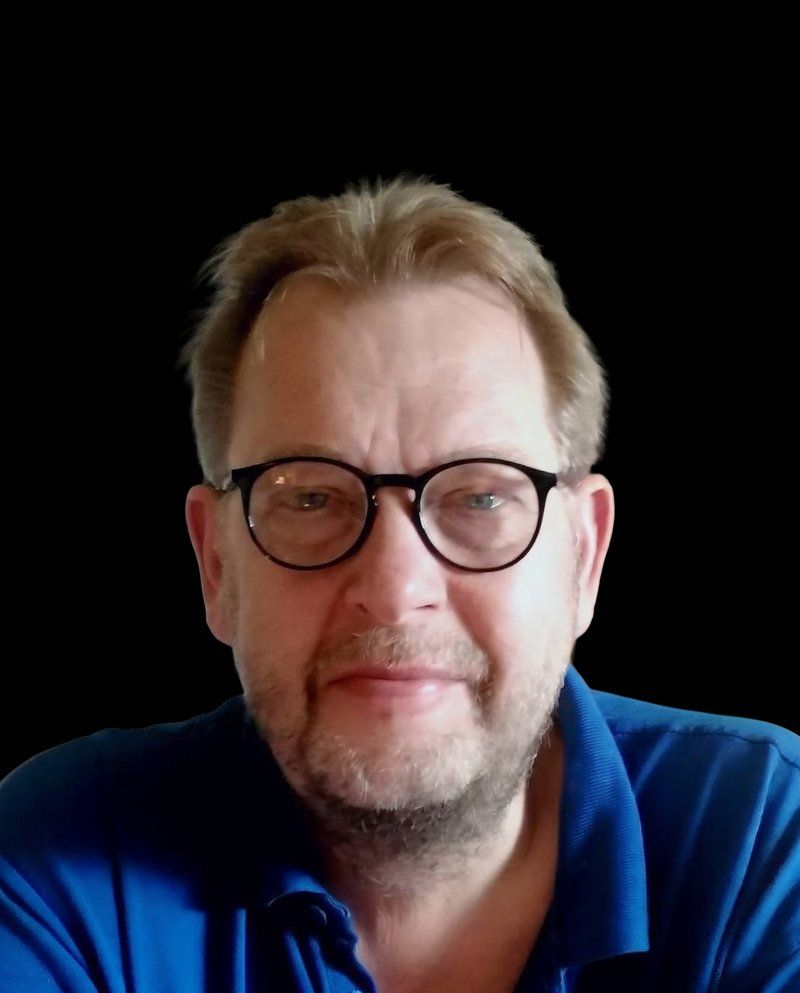

<!--
  HOME PAGE.
  The deep blue band at the top takes its colours from your LinkedIn
  banner. Your name, the line under it, the introduction and the photo
  sit inside it. Edit the words freely; keep the lines starting with
  ::: as they are, because they open and close the parts of the page.
-->

::: {.column-screen .board .hero-band}
::: {.board-inner}
<h1 class="hero-name"><span>Mads Henrik</span><span>Højgaard</span></h1>

::: {.hero .hero-with-photo}

::: {.hero-text}
<p class="hero-role">Researcher and analyst of Greek society, politics and economics</p>

::: {.hero-intro}
My academic and journalistic work is focused on contemporary Greek society, politics and economics, with a background in global studies, migration politics and international relations. I am a deeply curious human with a constant need to take in new knowledge and to analyze and learn.

::: {.hero-links}
[More about me](about.qmd) [The Double Economy](projects/double-economy.qmd)
:::
:::
:::

::: {.hero-photo}
{fig-alt="Portrait of Mads Henrik Højgaard"}
:::

:::
:::
:::

<!--
  FIGURES UNDER THE BAND.
  The number of articles is counted automatically from your lists of
  writing every time the site is built. The other three are written
  here: change the number or the words between the quotation marks.
-->

```{python}
#| output: asis
import sys
sys.path.insert(0, "_scripts")
import sitedata

pieces = sitedata.writing()
first_year = min(p["date"].year for p in pieces)

print(sitedata.tally_html([
    (len(pieces), f"articles and essays since {first_year}", "writing.qmd"),
    ("25+", "years in operational management, consultancy and project management", None),
    ("5", "years at Are You Syrious, 2018–2023", None),
    ("55+", "years old when I completed my MSc in Global Studies, 2019", None),
]))
```

## Areas of work

<ul class="areas">
  <li>Greek society</li>
  <li>Institutional accountability</li>
  <li>Structural inequality</li>
  <li>Housing</li>
  <li>Media freedom</li>
  <li>Political economy</li>
  <li>Other areas</li>
</ul>

::: {.section-head}
## Latest writing

[All writing](writing.qmd)
:::

::: {#latest}
:::

## Contact

<ul class="contact-lines">
  <li>Email: <a class="js-email" data-user="" data-domain="" href="contact.qmd">shown when the page loads</a></li>
  <li><a href="">LinkedIn</a></li>
</ul>
