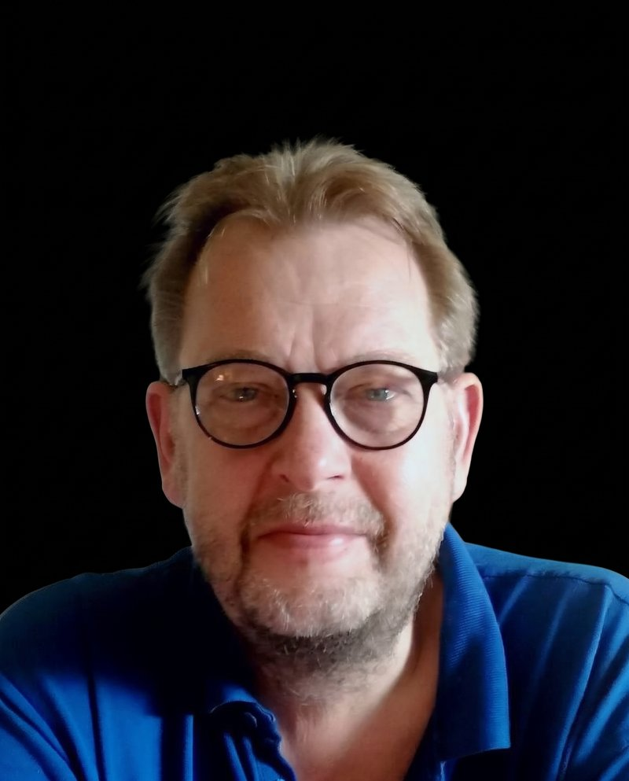

<h1 class="hero-name">Mads HenrikHøjgaard</h1>

::: {.hero .hero-with-photo}

::: {.hero-text}

Researcher and analyst of Greek society, politics and economics

::: {.hero-intro}
My academic and journalistic work is focused on contemporary Greek society, politics and economics, with a background in global studies, migration politics and international relations. I am a deeply curious human with a constant need to take in new knowledge and to analyze and learn.

[More about me](about.qmd)
:::
:::

::: {.hero-photo}
{fig-alt="Portrait of Mads Henrik Højgaard"}
:::

:::

## Areas of work

<ul class="areas">
  <li>Greek society</li>
  <li>Institutional accountability</li>
  <li>Structural inequality</li>
  <li>Housing</li>
  <li>Media freedom</li>
  <li>Political economy</li>
  <li>Other areas</li>
</ul>

::: {.section-head}
## Latest writing

[All writing](writing.qmd)
:::

::: {#latest}
:::

## Contact

<ul class="contact-lines">
  <li>Email: <a class="js-email" data-user="" data-domain="" href="contact.qmd">shown when the page loads</a></li>
  <li><a href="">LinkedIn</a></li>
</ul>
